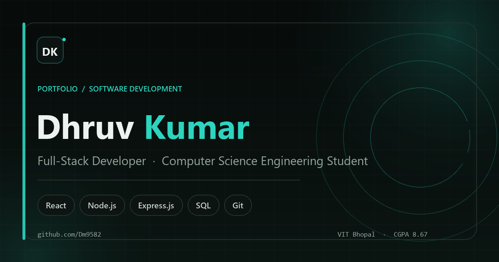

# Dhruv Kumar — Personal Portfolio

[](https://react.dev/)
[](https://vite.dev/)
[](https://tailwindcss.com/)
[](https://www.framer.com/motion/)

**Repository:** [github.com/Dm9582/Portfolio](https://github.com/Dm9582/Portfolio)



A modern, animated personal portfolio built from the resume in this project. It presents Dhruv's summary, skills, ServiceNow internship, projects, education, certifications, and contact details in a single-page experience.

- Dark mode by default with a remembered light-mode toggle
- Responsive mobile-first layout and accessible navigation
- Framer Motion reveals, typing effect, scroll progress, counters, and desktop cursor glow
- Content lives in one data file — no component edits needed to update the resume details
- Working contact form that validates locally and opens the visitor's email client
- SEO metadata, JSON-LD, favicon, Apple touch icon, and an Open Graph cover image

## Tech stack

| Tool | Purpose |
| --- | --- |
| [React 18](https://react.dev/) + [Vite](https://vite.dev/) | App and build tooling |
| [Tailwind CSS 3](https://tailwindcss.com/) | Styling and design tokens |
| [Framer Motion](https://www.framer.com/motion/) | Page, scroll, and hover animations |
| [Lucide React](https://lucide.dev/) | Icons |
| Google Fonts | Inter (body) and Poppins (display) |

The production bundle has no runtime dependencies beyond React, Framer Motion, and Lucide.

## Run locally

Prerequisites: **Node.js 20.19+** (Node 22 is recommended). The repo includes an `.nvmrc` set to Node 22.

```bash
npm install
npm run dev
```

Open the URL Vite prints (usually `http://localhost:5173`).

Other scripts:

```bash
npm run build    # production build into dist/
npm run preview  # preview the production build locally
```

## Project structure

```text
portfolio/
├─ public/
│  ├─ favicon.svg
│  ├─ apple-touch-icon.png
│  ├─ og-image.png
│  ├─ resume.pdf          # downloadable resume (replace with your latest)
│  └─ robots.txt
├─ src/
│  ├─ components/         # shared UI: navbar, buttons, reveals, counters, etc.
│  ├─ context/            # dark/light theme provider
│  ├─ data/
│  │  └─ resume.js        # ← all portfolio content lives here
│  ├─ hooks/              # active-section tracking
│  ├─ sections/           # Hero, About, Skills, Experience, Projects, Education, Contact
│  ├─ utils/              # public-asset URL helper
│  ├─ App.jsx
│  ├─ index.css           # design tokens, global styles, reduced-motion rules
│  └─ main.jsx
├─ .github/workflows/deploy.yml  # GitHub Pages deployment
├─ netlify.toml
├─ vercel.json
└─ index.html             # SEO / Open Graph metadata
```

## Edit your content

Everything textual comes from **`src/data/resume.js`**. Update that file and the page refreshes automatically in dev.

Key fields:

| Field | What it controls |
| --- | --- |
| `name`, `firstName`, `lastName`, `initials` | Name and monogram |
| `roles` | Roles cycled by the hero typing effect |
| `tagline`, `availability` | Hero supporting copy and status pill |
| `summary` | About section paragraphs |
| `photo` | Portrait path; `null` shows the designed placeholder |
| `contact` | Email, phone, GitHub, LinkedIn |
| `socials` | Icons in the hero and footer |
| `stats` | About section counters |
| `skills` | Skill groups and badge lists |
| `experience` | Timeline entries |
| `projects` | Cards, tags, repository and live-demo links |
| `education`, `certifications` | Education/certification cards |
| `resumeFile` | Filename in `/public` used by all download buttons |
| `achievements` | Currently empty because the resume has no achievements section |

### Add your photo

1. Put a portrait in `public/`, for example `public/portrait.jpg`.
2. Set `photo: 'portrait.jpg'` in `src/data/resume.js`.
3. Keep the image roughly portrait-oriented (4:5). The component lazy-loads and crops it with `object-cover`.

When `photo` is `null`, an intentional placeholder card is shown, so the layout never looks broken.

### Replace the resume

Replace `public/resume.pdf` with the new PDF. If you rename it, update `resumeFile` in `src/data/resume.js`. The nav, hero, education, mobile menu, and contact section all use the same file.

### Add live project links

Set `live` on a project in `src/data/resume.js`:

```js
live: 'https://your-project.example.com',
```

If `live` is `null`, the card shows “Live demo unavailable” instead of a dead link.

Current verified status (checked against the GitHub repositories on 8 Nov 2026):

| Project | Live deployment | Status |
| --- | --- | --- |
| EDUCHECK | https://educheck-rust.vercel.app | Verified — HTTP 200, login and register pages load |
| MedSync | https://medsync-hospital.vercel.app | Verified — HTTP 200, demo login, dashboard, and AI chat API work |

**Note:** Both repositories' GitHub **Homepage** fields now point to the verified deployments. EDUCHECK's old field (`educheck-five.vercel.app`) was an empty React starter; MedSync's old README link (`medsync-demo.vercel.app`) served an unrelated product and has been replaced with the new deployment URL.

### Change colours and fonts

- Colour tokens live at the top of `src/index.css` (`:root` for light, `.dark` for dark).
- The single accent colour is `--c-accent`; changing it updates buttons, links, glows, and badges.
- Font imports are in `index.html` (Google Fonts).
- Body copy is Inter; headings use Poppins.

## Contact form

The form validates name, email, and message locally, then opens the visitor's email client with a prefilled message to `dhruv95682@gmail.com`. Nothing is stored on the site; the UI states this clearly.

To collect messages through a form service instead, replace the `window.location.href = url;` portion of `handleSubmit` in `src/sections/Contact.jsx` with a `fetch` POST to your provider (for example Formspree), then show the success panel after the request resolves. Add the provider's endpoint to an environment variable — never hardcode secrets in the client.

## Accessibility and motion

- Semantic landmarks, a skip link, visible focus styles, and labelled form controls.
- Mobile navigation locks the page, marks background content `inert`, supports Escape, and returns focus to the menu button.
- `prefers-reduced-motion` is respected by CSS and by Framer Motion's `MotionConfig`.
- The custom cursor glow is desktop-only and disabled for reduced motion.
- No stock photos or large image assets are loaded; the portrait is lazy-loaded when supplied.
- The interface was checked with axe-core in dark, light, and mobile-menu states.

## Deploy

### Vercel

1. Push the project to GitHub.
2. Import the repository at [vercel.com/new](https://vercel.com/new).
3. Vercel detects Vite automatically. Build command: `npm run build`; output directory: `dist`.
4. Deploy. `vercel.json` is included for explicit settings.

### Netlify

1. Push the project to GitHub, then add a new site from Git in Netlify.
2. Netlify reads `netlify.toml` (build `npm run build`, publish `dist`).
3. Deploy. You can also drag the generated `dist` folder into Netlify's manual deploy area.

### GitHub Pages

1. Push to a GitHub repository with `main` as the default branch.
2. In **Settings → Pages**, set **Source** to **GitHub Actions**.
3. The included workflow (`.github/workflows/deploy.yml`) builds and deploys on every push to `main`.
4. For a custom domain, configure it in the Pages settings.

Vite's `base` is set to `./`, so the site also works under a GitHub Pages project subpath without editing configuration.

### After your first deploy

1. Replace the relative `og:image` / `twitter:image` paths in `index.html` with absolute URLs, for example `https://your-domain.com/og-image.png`.
2. Optionally add the final URL as a canonical link and to the JSON-LD Person schema.
3. Test the deployed contact links and download button.

## Content notes / what is still missing

These items were **not present** in the source resume, so they were not invented:

- **Profile photo** — a designed placeholder is used; add one as described above.
- **Live project demos** — both projects are linked to verified deployments. MedSync runs in demo mode with the credentials shown on its login screen (`demo@medsync.com` / `123456`); the AI assistant uses its built-in fallback responses until an OpenAI key is configured.
- **Achievements** — the resume has no achievements section, so the section is intentionally omitted.
- **Years of experience** — not claimed. The resume lists one virtual internship, so the About stats show “1 Virtual internship” rather than a fabricated number of years.
- **Phone country code** — the resume prints `+9565145878`. Confirm whether the number needs a country code (for example `+91`) and update `contact.phone` / `contact.phoneHref`.
- **EDUCHECK tech stack** — the resume lists modules (real-time chat, attendance, course management) but not technologies, so tags describe the modules rather than claiming a stack.
- **Live credential links** — no certification verification URLs were included.
- **Location** — not stated in the resume, so it is not displayed.
- **Project screenshots** — not supplied; cards use original CSS artwork instead.

The “Zurich” wording in the ServiceNow micro-certification title is preserved exactly as it appeared in the resume.

---

Built for Dhruv Kumar with React, Tailwind CSS, Framer Motion, and Lucide.
